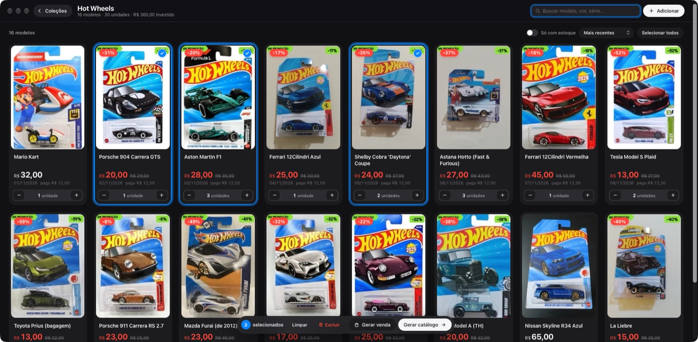
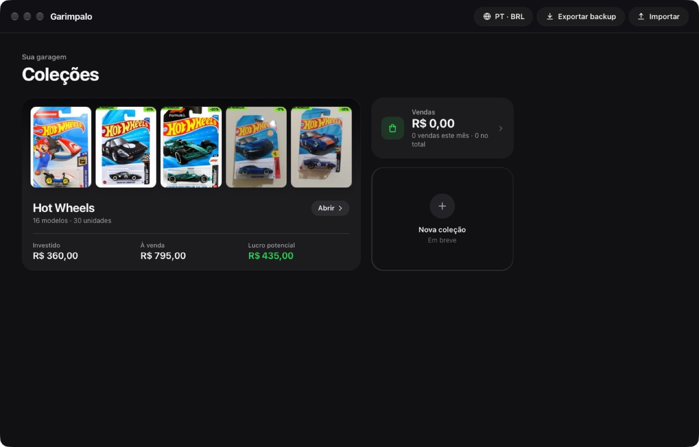
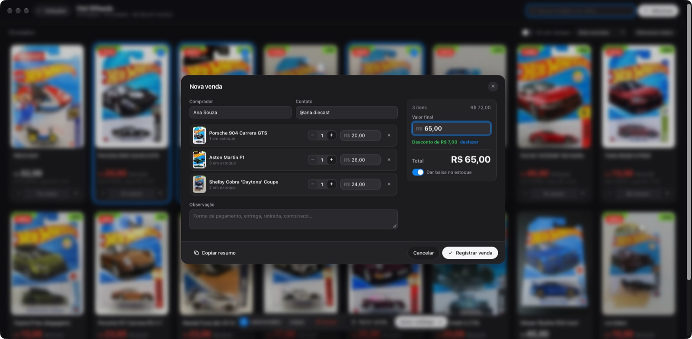
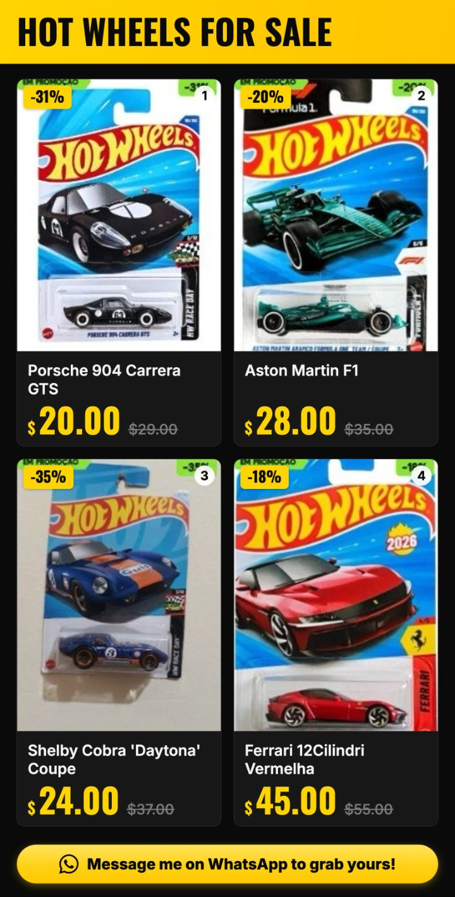

<p align="center">
  
</p>

<h1 align="center">Garimpalo</h1>

<p align="center">
  Organize sua coleção de Hot Wheels e venda pelo WhatsApp.<br />
  <em>Organize your Hot Wheels collection and sell it on WhatsApp.</em>
</p>

<p align="center">
  <a href="../../releases/latest"><b>⬇ Baixar / Download</b></a> ·
  macOS (Apple Silicon + Intel) · Windows ·
  <a href="#português">Português</a> · <a href="#english">English</a>
</p>

<p align="center">
  
</p>

<p align="center">
  
  
  
  
</p>

---

## Português

App desktop para quem coleciona e revende carrinhos: cadastra a coleção com fotos e preços, gera **catálogos prontos para o WhatsApp** e registra as **vendas** com baixa no estoque. Tudo fica no seu computador; nada vai para a internet.

### O que faz

- **Garagem**: cada modelo com até **3 fotos** (a 1ª é a capa), descrição, quantidade, data e valor pago, preço de venda e preço promocional. Busca sem acento, ordenação e botões −/+ de estoque.
- **Fotos sem trabalho**: clique, arraste ou cole (⌘/Ctrl+V). Cada foto vira **WebP** na hora. O editor recorta (Livre, 3:4, 1:1, 4:3), endireita em **perspectiva** (arraste os 4 cantos até a quina da cartela), gira e ajusta brilho, contraste, vibração, saturação, temperatura e nitidez, sem perder o original.
- **Catálogo**: escolha os modelos e gere imagens com **1, 4, 9 ou 16 por página** em **7 temas**: WhatsApp claro e escuro, Vitrine, Oferta, Pista, Colecionador e Neon. Preço em destaque, preço antigo riscado e selo de desconto nas promoções, e cada modelo numerado para o cliente pedir "quero o 5". Salva em JPG, copia a imagem para colar no WhatsApp ou copia a lista em texto.
- **Vendas**: selecione os modelos e toque em **Gerar venda**: comprador, contato, valor combinado por item, valor final com desconto ou acréscimo, observação e baixa no estoque. O resumo sai pronto para o WhatsApp, e a tela **Vendas** guarda o histórico (dá para desfazer e devolver ao estoque).
- **Backup**: exporta tudo (dados, fotos e vendas) num único `.zip` e importa de volta (mesclar ou substituir).
- **Português ou inglês**, em reais, dólares ou euros (botão no canto da tela inicial). Visual de app do Mac, com modo claro e escuro automáticos.

<p align="center">
  
  
</p>

### Instalar

Baixe na página de [**Releases**](../../releases/latest):

- **Mac**: `Garimpalo_<versão>_universal.dmg` → arraste para Aplicativos.
- **Windows**: `Garimpalo_<versão>_x64-setup.exe` (ou o `.msi`).

Os instaladores ainda não são assinados. Na primeira vez:
- **Mac**: botão direito no app → **Abrir** → **Abrir**. Se aparecer "está danificado", rode `xattr -cr /Applications/Garimpalo.app` no Terminal.
- **Windows**: na tela azul do SmartScreen, **Mais informações → Executar assim mesmo**.

Para testar com dados, importe `exemplo/backup-exemplo-16-carros.zip` (Início → Importar).

### Onde ficam os dados

- macOS: `~/Library/Application Support/com.garimpalo.app/`
- Windows: `%APPDATA%\com.garimpalo.app\`

Lá ficam `garimpalo.db` (SQLite) e `images/` (original de cada foto e a versão final em WebP). Formatos aceitos: JPG, PNG, WebP, GIF e BMP (HEIC do iPhone ainda não; exporte como JPG).

---

## English

A desktop app for people who collect and resell die-cast cars: catalog your collection with photos and prices, create **WhatsApp-ready sales catalogs** and record **sales** that update your stock. Everything stays on your computer; nothing is uploaded.

<p align="center">
  
</p>

### Features

- **Garage**: up to **3 photos** per model (the first is the cover), description, quantity, date and price paid, sale price and promo price. Accent-insensitive search, sorting and −/+ stock buttons.
- **Effortless photos**: click, drag or paste (⌘/Ctrl+V). Each photo is converted to **WebP** right away. The editor crops (Free, 3:4, 1:1, 4:3), straightens in **perspective** (drag the 4 corners to the corners of the card), rotates and adjusts brightness, contrast, vibrance, saturation, temperature and sharpness, always keeping the original.
- **Catalog**: pick the models and create images with **1, 4, 9 or 16 per page** in **7 themes** (WhatsApp light and dark, Showcase, Flash sale, Track, Collector and Neon). Big prices, struck-through old price and a discount badge on promos, and every model is numbered so buyers can say "I'll take #5". Save as JPG, copy the image to paste into WhatsApp, or copy the list as text.
- **Sales**: select the models and click **Record sale**: buyer, contact, agreed price per item, final amount with discount or surcharge, notes, and stock deduction. The summary is ready to paste into WhatsApp, and the **Sales** screen keeps the history (sales can be undone, returning the units to stock).
- **Backup**: export everything (data, photos and sales) to a single `.zip` and import it back (merge or replace).
- **English or Portuguese**, in US dollars, euros or reais (button in the corner of the home screen). A native macOS look, with automatic light and dark mode.

### Install

Download from [**Releases**](../../releases/latest):

- **Mac**: `Garimpalo_<version>_universal.dmg` → drag it into Applications.
- **Windows**: `Garimpalo_<version>_x64-setup.exe` (or the `.msi`).

The installers aren't signed yet. The first time:
- **Mac**: right-click the app → **Open** → **Open**. If it says the app "is damaged", run `xattr -cr /Applications/Garimpalo.app` in Terminal.
- **Windows**: on the blue SmartScreen screen, click **More info → Run anyway**.

To try it with sample data, import `exemplo/backup-exemplo-16-carros.zip` (Home → Import).

---

## Desenvolvimento / Development

Built with **Tauri 2 + Rust** (SQLite, image processing) and **React + TypeScript** (UI). Requires Rust (stable) and Node 18+.

```bash
npm install
```

```bash
npm run tauri dev
```

The dev server runs on port **1430**. Rust tests (backup, images, sales, safety):

```bash
cd src-tauri && cargo test
```

Build an installer for the current OS:

```bash
npm run tauri build
```

**Mac + Windows at once (GitHub Actions):** `.github/workflows/build.yml` builds the universal `.dmg` and the Windows `.exe`/`.msi`. Run it from **Actions → Build → Run workflow** or push a `v*` tag; the files land in the release for the version in `src-tauri/tauri.conf.json` (bump it for a new release, otherwise the current release's files are replaced).

**Translations:** UI text sits side by side in the code as `L("Salvar", "Save")` (`src/i18n.ts`); error messages from Rust are translated in `src/api.ts`.

```
src-tauri/src/
  lib.rs      commands called by the UI
  db.rs       SQLite schema and queries
  photos.rs   photos: import, EXIF orientation, crop/perspective, color, WebP
  photocraft/ homography, perspective crop and color adjustments (adapted from PhotoCraft, MIT)
  backup.rs   .zip export/import
  sales.rs    sales: record (with stock deduction), list, undo
src/
  i18n.ts     language and currency
  components/ Home, Garage, CarForm, PhotoSlots, PhotoEditor, FramedImage, Catalog, SaleForm, Sales
  catalog/render.ts  draws the catalog pages (canvas) in the 7 themes
```

## Créditos / Credits

The perspective crop (homography + true aspect ratio) and the color adjustments were adapted from **PhotoCraft**, under the MIT license — see `src-tauri/src/photocraft/LICENSE-MIT`.

Hot Wheels is a trademark of Mattel, Inc. Garimpalo is an independent project, not affiliated with or endorsed by Mattel.
